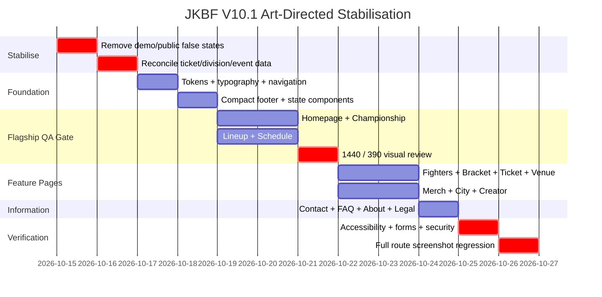

# JKBF Public Website UI/UX Audit and Competitive Benchmark

## Executive summary

The current JKBF public site is **substantially better than the earlier V8/V9 iterations**, but your concern is valid: it still does not yet feel like a deliberately art-directed premium sports-and-culture event website.

The central problem is no longer simply “too much content”. It is **over-systematisation**.

The site repeatedly uses the same visual grammar—eyebrow, large heading, paragraph, bordered block, black/ivory section, filters, cards, then a long sitemap/footer. As a result, pages with completely different purposes—fighters, championship, schedule, contact, merchandise, festival information—feel as though they were generated from one template rather than individually composed.

The current contact page illustrates this clearly. It has sensible content and visible form labels, but the form, office information, header and large repeated footer consume substantial vertical space. Its information hierarchy is technically functional but visually flat: nearly every region is another rectangle. The live page currently asks for name/organisation, email, WhatsApp, category and message, followed by secretariat, venue, email, response-time and ticket-help information. citeturn1view0

More importantly, this audit found **content-integrity issues that should be fixed before further visual polish**:

| Priority | Finding | Risk |
|---|---|---|
| **P0** | Public bracket currently contains `Fighter Demo` names, `COMPLETED` states and apparent winners. citeturn2view3 | Visitors may interpret simulated tournament data as official results. |
| **P0** | Public fighter directory describes itself as an official roster while listing demo fighters. citeturn2view4 | Credibility / event-information risk. |
| **P0** | Homepage CTA says **“AMANKAN TIKET SEKARANG”**, while the ticket page says **“INFO TIKET SEGERA HADIR”** and that official sales have not yet opened. citeturn1view1turn10view0 | Misleading conversion state. |
| **P0** | Competition classes/weights differ between homepage and championship pages. citeturn1view1turn2view1 | Official competition data cannot have two sources of truth. |
| **P1** | Schedule prints `WIB WIB`. citeturn2view0 | Visible quality-control regression. |
| **P1** | Several public product/line-up labels use **JKB** instead of **JKBF**. citeturn2view2turn11view2 | Brand inconsistency. |
| **P1** | Privacy copy says passwords are “encrypted”; if this describes the implementation literally, password storage should be reviewed because OWASP recommends strong password hashing rather than reversible encryption. citeturn11view5turn12search0turn12search2 | Security wording/implementation risk. |

**My strongest recommendation is therefore not another cosmetic V10.1 pass.** Freeze the current public design as the technical foundation, fix the P0 data/state issues, then perform one tightly controlled **art-directed composition rebuild** in which different page families deliberately use different visual structures while sharing the same JKBF identity.

The correct target is:

> **one brand system, several editorial scene languages — not one reusable landing-page template across twenty-three routes.**

The V10 brief you already prepared is directionally correct. What it needs now is stricter composition rules, smaller repeated chrome, and a quality gate based on rendered screenshots rather than prompt compliance.

## Current-state visual and UX audit

I live-crawled the JKBF site on 15 October 2026 and inspected the homepage, contact, schedule, championship, fighters, bracket, lineup, venue, ticket, about, merchandise, FAQ, City Pride, Creator Hub, terms and privacy routes. The live markup confirms a consistent global shell and a broad set of functioning information pathways. citeturn1view1turn2view0turn2view1turn2view2turn10view0turn11view0turn11view1turn11view2turn11view3

Pixel-accurate live desktop browser rendering is not available through this research environment, so I will **not fabricate a 1440 px screenshot**. The visual evidence below uses the latest screen recordings you supplied; the required 1440×900 live screenshots are therefore part of the Antigravity acceptance checklist later in this report.

### Contact page


The left side is the current JKBF contact experience from your latest recording; the right side is BYON from the reference recording you supplied.

The difference is not that BYON contains less “design”. It has **fewer simultaneously active design decisions**.

JKBF currently presents:

- global header,
- large form container,
- individual field borders,
- monospaced uppercase labels,
- oversized submit region,
- separate secretariat card,
- additional venue/email/response information,
- and, after that, the global footer.

The page therefore has several nested levels of framing.

The underlying information is actually good: JKBF explains that the page handles general enquiries, partnerships, sponsorship proposals and media accreditation, gives a correspondence email, identifies the event venue and states a response target of one working day. citeturn1view0

The design should allow that information to breathe rather than make each item a new block.

### What should change on `/kontak`

**Desktop 1440 px**

Use a restrained 12-column layout:

```text
┌─────────────────────────────────────────────────────────────┐
│ JKBF                                  NAV        INFO TIKET │
├─────────────────────────────────────────────────────────────┤
│                                                             │
│ CONTACT JKBF                                                │
│ MARI TERHUBUNG.            ┌─────────────────────────────┐  │
│                             │ Name                        │  │
│ Questions, partnership,     │ Email                       │  │
│ media and event support.    │ WhatsApp optional           │  │
│                             │ Topic                       │  │
│ Email                       │ Message                     │  │
│ Response time               │                             │  │
│ Ticket help                 │ SEND MESSAGE                │  │
│                             └─────────────────────────────┘  │
│                                                             │
├─────────────────────────────────────────────────────────────┤
│ Need ticket help?  FAQ · Ticket information · Venue        │
├─────────────────────────────────────────────────────────────┤
│ compact footer                                               │
└─────────────────────────────────────────────────────────────┘
```

No giant marketing hero is required. Contact is an **information page**, not an advertising campaign.

On mobile, the desired order is:

**MARI TERHUBUNG → email/response shortcuts → form → ticket-help link → compact office details → footer.**

The secretariat data should be a simple definition list, not another visually dominant card.

WhatsApp should only be mandatory if the organisation genuinely needs it for every enquiry. Currently it is displayed as required. citeturn1view0 Making it optional for ordinary enquiries would reduce friction and unnecessary personal-data collection.

### Overall public-site composition


This comparison reveals why JKBF still feels more “designed from components” than “art-directed”.

JKBF has already improved enormously: strong black/ivory separation, larger typography, real negative space, monochrome combat imagery and a clean navigation bar.

But its page architecture remains predictable:

```text
EYEBROW
BIG TITLE
DESCRIPTION
IMAGE
SECTION LABEL
SECTION TITLE
CONTROL / CARDS
...
LONG FOOTER
```

Once that structure appears repeatedly, the visitor starts seeing the template rather than the event.

BYON uses image-led sports storytelling far more aggressively and gives visual assets substantial uninterrupted space. Its current official site also foregrounds fight content, past fights and PPV conversion rather than presenting every function through identical utility cards. citeturn6view0

The goal is **not to clone BYON**. JKBF is broader: it combines championship, festival, music, community, practical visitor information and commerce. The lesson is to give each category its own scene language.

### Typography

Current JKBF typography is visually coherent but overuses:

- uppercase,
- condensed/monospaced-looking utility text,
- letter spacing,
- small red eyebrow labels,
- and similarly weighted headings.

That causes metadata, navigation, labels and important information to compete.

Use three clearly separated roles:

| Role | Recommendation |
|---|---|
| Campaign/display | **Archivo Black** or a similarly forceful display face |
| UI/body | **Manrope** |
| Technical metadata | **IBM Plex Mono**, sparingly |

Mono should be reserved for items such as:

`12–14 DEC`, `63.5 KG`, `19:00 WIB`, `BOUT 04`.

It should **not** be the default language for every form label, office address and navigation item.

### Spacing and density

The problem is not insufficient whitespace everywhere. Some pages have plenty of whitespace.

The problem is **fragmented whitespace**: many small margins surrounding many separate components.

Premium compositions usually feel spacious because they use fewer visual objects, each given more room.

Recommended spacing foundation:

```css
--space-1: 4px;
--space-2: 8px;
--space-3: 12px;
--space-4: 16px;
--space-5: 24px;
--space-6: 32px;
--space-7: 48px;
--space-8: 64px;
--space-9: 96px;
--space-10: 128px;
```

Use:

- mobile page gutter: **20–24 px**
- tablet gutter: **32 px**
- desktop gutter: **64–80 px**
- maximum main canvas: **1240–1280 px**
- text measure: **620–720 px**
- standard mobile section gap: **64–88 px**
- flagship desktop section gap: **104–144 px**

Do **not** achieve spaciousness by creating empty 100vh sections.

### Header, menu and footer

The current mobile header is already one of the stronger areas. Logo + ticket action + menu is simple.

The mobile menu and footer are the bigger problem.

Your latest recording shows a menu containing many destination groups and then a similarly exhaustive footer. Because the same full information architecture is repeated on every route, users repeatedly encounter a “link wall”.

The preferred mobile navigation is:

**Primary**

`Jadwal`  
`Pertandingan`  
`Musik`  
`Info Tiket`

**Explore**

`Fighters · Bracket · Merch · City Pride · Creator`

**Plan**

`Venue · FAQ · Contact · About`

Terms/privacy belong in the footer.

Admin access does **not** belong in public navigation or the public footer. Its visibility is not itself a security vulnerability, but removing it eliminates irrelevant public chrome; the admin endpoint must still be protected independently by authentication and authorisation.

## Competitive comparison

The strongest benchmark is not any one website. Different JKBF page families should borrow different structural principles from the references.

| Reference | What it does well | JKBF application |
|---|---|---|
| **BYON Combat** | Large, emotionally dominant combat media; simple header; direct PPV/fight pathways; comparatively sparse composition. Its official site centres fights, past events and purchase/watch actions. citeturn3search0turn6view0 | Homepage, Championship, Fighters, PPV |
| **GLORY** | Event pages establish event, date/venue, countdown, ticket/watch actions and then fight card; ticket listings expose clear event-to-purchase paths. citeturn6view2turn6view3 | Championship, Ticket, Fight Card |
| **UFC** | Official events/tickets pages organise event schedules and purchase paths around individual events rather than generic landing-page sections. citeturn0search1turn0search4turn0search25 | Event overview and ticket flow |
| **Sónar** | Timetable is task-oriented: day selectors, category and stage filters; line-up can be explored by day. Its app also supports stage/time/artist filtering and saved activities. citeturn6view6turn6view7turn0search23 | `/jadwal`, `/lineup` |
| **Gymshark** | Product pages establish product, price, fit, variants, size, stock/action and delivery before extended marketing detail. citeturn6view8 | Merch catalogue and PDP |
| **Tomorrowland** | Festival information and line-up are visually branded but still split into clear practical/line-up/ticket domains; current official festival properties expose explicit ticket states including sold-out/on-sale states. citeturn5search9turn5search17turn5search37 | Music/culture scene language and ticket states |

### What BYON gets right that JKBF still misses

BYON's official mobile structure is highly confident because individual sections frequently have **one job**: one fight visual, one conversion action, one about statement or one list of events. citeturn6view0

JKBF often gives a section four jobs simultaneously:

title + description + status + metadata + CTA + decorative label + card.

The solution is not “make everything bigger”.

The solution is:

> **reduce the number of independently styled objects per viewport.**

### What GLORY teaches JKBF

GLORY's current event structure establishes the fight, countdown/date, venue, times and ticket/watch actions, and then presents the card. citeturn6view3

JKBF should therefore make `/championship` immediately answer:

**What championship?  
When?  
Where?  
What is confirmed?  
What can I do next?**

Rules are secondary information.

They should not compete with the primary fight-night narrative.

### What Sónar teaches the schedule

Sónar's official timetable exposes three day controls and filtering by category and stage rather than forcing visitors through marketing sections. citeturn6view6

JKBF already has 12/13/14 day controls, which is directionally correct. citeturn2view0

The redesign should go further:

```text
SAT 12      SUN 13      MON 14

09:00
Official Weigh-in
Main Hall

13:30
Bantamweight / Featherweight
Ring Utama
MAIN BOUT

18:30
Opening Ceremony
Main Stage
```

Thin dividers. Minimal cards. Time first.

### What Gymshark teaches merchandise

JKBF merchandise should stop inheriting the combat-information visual system.

Gymshark establishes product title, fit, price, variant/size selection, availability, purchase action and delivery information before extended product storytelling. citeturn6view8

JKBF currently exposes search/categories and products effectively, but even its product naming contains `JKB` rather than `JKBF`. citeturn11view2

The merch area should feel like:

**fashion photography + product facts**, not tournament cards.

## Priority findings and concrete fixes

### Immediate content and state fixes

These should happen **before** a large visual rebuild.

| Issue | Current evidence | Fix | Acceptance criterion |
|---|---|---|---|
| Demo bracket exposed publicly | `Fighter Demo`, `COMPLETED` and apparent winners appear on `/bracket`. citeturn2view3 | Public state must display `Draw not announced` until verified event data exists. | Zero strings matching `Demo`, fake winners or fake completed results in public production. |
| Demo fighters presented as roster | `/fighters` advertises an official roster while showing demo names. citeturn2view4 | Replace with approved fighters or a designed announcement state. | Every visible athlete has explicit approval/source status. |
| Ticket CTA mismatch | Homepage says secure ticket now; ticket page says sales are forthcoming. citeturn1view1turn10view0 | Introduce ticket-state component. | `COMING_SOON` never renders a purchase verb. |
| Division mismatch | Homepage and championship pages give different classes/weights. citeturn1view1turn2view1 | Single shared data source. | Division name + weight identical across every route. |
| Athlete-count mismatch | Schedule mentions 80 athletes while championship format states four 8-person divisions. citeturn2view0turn2view1 | Verify with EO; remove unsupported numbers until confirmed. | One approved count source. |
| Duplicate timezone | `WIB WIB`. citeturn2view0 | Time formatter owns suffix once. | No duplicated timezone labels. |
| Brand typo | `JKB` appears in lineup/merch content. citeturn2view2turn11view2 | Global copy sweep. | Public copy consistently uses JKBF unless another name is intentional. |

### Quick visual wins

These require little architectural risk.

**Reduce the footer by roughly 50–65% on mobile.**

Keep:

`JKBF identity · date/location · 6–8 useful links · legal/social`.

Remove the repeated full route catalogue.

**Limit eyebrow copy.**

At most one eyebrow per scene.

**Stop wrapping every information group in a bordered card.**

A section can simply be typography + divider.

**Reduce button competition.**

One solid primary action and maximum one secondary text link per scene.

**Remove permanent arrows from ordinary labels.**

Use arrows when they communicate navigation, not as decoration.

### Medium redesign work

Build four shared **scene primitives**, not forty generic cards.

**CombatScene**

Photography, athlete match-ups, results/state, divisions.

**StageScene**

Music imagery, artist typography, day/stage.

**CultureScene**

Community/Jogja identity, optional Tugu/Prambanan/Borobudur line art.

**InformationScene**

Ivory background, readable typography, schedules, forms, FAQ and legal content.

This lets routes remain brand-related without becoming visually identical.

### Major art-direction work

The homepage should stop functioning as a catalogue of features.

Use four chapters:

```text
HERO
Event identity / date / venue / ticket status

THE RING
One strong fight-led composition

THE STAGE
One visually different music-led composition

PLAN YOUR FESTIVAL
schedule / venue / ticket information

JOGJA PUNYA NYALI
community close
```

The existing homepage already includes championship, stages, three-day schedule and city-pride content. citeturn1view1 The redesign is therefore mostly a **hierarchy and composition change**, not a feature removal.

## Accessibility, form quality and security review

### Accessibility

The site already has some positive fundamentals.

The live crawler detects meaningful image alternatives on several pages—for example the homepage fight documentation image, championship belt/division images and named fighter images. citeturn1view1turn2view1turn2view4

The contact form also exposes visible labels rather than relying exclusively on placeholders. citeturn1view0

Several improvements are still needed.

#### Heading structure

On `/kontak`, the document has an H1 followed by H3 subsections such as `KIRIM PESAN LANGSUNG` and `KANTOR PANITIA JKBF`, without a semantic H2 between them. citeturn1view0

W3C recommends nesting headings according to content hierarchy so structure is programmatically understandable. citeturn14search0turn14search8

Target:

```html
<h1>Mari terhubung</h1>

<h2>Kirim pesan</h2>

<h2>Sekretariat JKBF</h2>

<h2>Bantuan tiket</h2>
```

#### Contrast

WCAG 2.2 requires at least **4.5:1** for ordinary text and **3:1** for large text, subject to defined exceptions. citeturn5search2

The light-grey helper copy, placeholders and footer metadata visible in the recording should therefore be tested programmatically rather than approved by eye.

Acceptance:

- body text ≥ 4.5:1,
- functional borders/focus indicators ≥ 3:1 where required,
- no critical state communicated solely through red.

#### Touch targets

WCAG 2.2's minimum target criterion is 24×24 CSS px subject to exceptions; a more comfortable JKBF design target should be **44–48 px** for primary mobile controls. citeturn14search1

Recommended:

```css
min-height: 48px;
```

for buttons, filter chips and form controls.

#### Form errors

WCAG requires automatically detected errors to be identified and described in text, while labels/instructions should help users enter valid data. citeturn5search18turn5search26

Contact/Creator forms should provide:

```text
Email
[invalid@example]

Enter a valid email address, for example name@example.com.
```

not merely a red border.

### Contact form UX

Recommended field structure:

```text
Nama / Instansi *
Email *
WhatsApp
Topik *
Pesan *
```

Use placeholders only as examples, never as the only labels.

Submit state:

```text
Sending…
```

Success state:

```text
Pesan diterima.

Referensi: JKBF-CNT-02491
Tim kami akan merespons maksimal 1×24 jam kerja.
```

Failure:

```text
Pesan belum terkirim.
Data Anda tetap ada. Coba lagi atau email info@…
```

This is substantially better than a generic toast.

### Security and privacy

The public Contact and Creator forms collect personal data, and JKBF's privacy page explicitly says it collects names, phone numbers, email addresses and enquiry details. citeturn11view5 Indonesia's Law No. 27 of 2022 regulates personal-data processing and controller obligations. citeturn12search1

Required implementation controls:

- server-side validation,
- length limits,
- sanitisation/encoding,
- rate limiting,
- anti-spam protection,
- no sensitive form content in application logs,
- CSRF protection where a state-changing authenticated request is cookie-based,
- clear retention/deletion process.

OWASP recommends validating input before use and treats input validation as one layer of defence rather than the sole security control. citeturn5search11 CSRF protections should also be used where relevant to authenticated state-changing requests. citeturn5search3

The wording on the privacy page should be checked carefully:

> `kata sandi terenkripsi`

If the implementation literally uses reversible encryption for passwords, that should change. OWASP recommends dedicated slow password hashing algorithms such as Argon2id, bcrypt or PBKDF2, and specifically advises against reversible password encryption. citeturn12search0turn12search2

A safer public statement is:

> **Password credentials are protected using industry-standard secure password hashing.**

only after that implementation is verified.

### Voting and commercial routes

`/city-pride` claims “1 account = 1 vote”. citeturn11view0

Acceptance testing must therefore verify enforcement **server-side**, not merely disable the button in React.

Similarly, Ticket, checkout and PPV states must remain controlled by approved business state. The current ticket page explicitly says official sales are not yet available. citeturn10view0

No redesign should accidentally turn an unavailable state into a purchase state.

## Antigravity implementation blueprint

### Page-family architecture

```mermaid
erDiagram
    PUBLIC_SHELL ||--o{ PUBLIC_PAGE : contains
    PUBLIC_SHELL ||--|| HEADER : uses
    PUBLIC_SHELL ||--|| MOBILE_MENU : uses
    PUBLIC_SHELL ||--|| FOOTER : uses

    PUBLIC_PAGE ||--o| COMBAT_SCENE : may_use
    PUBLIC_PAGE ||--o| STAGE_SCENE : may_use
    PUBLIC_PAGE ||--o| CULTURE_SCENE : may_use
    PUBLIC_PAGE ||--o| INFORMATION_SCENE : may_use

    CONTACT_PAGE ||--|| CONTACT_FORM : contains
    CONTACT_PAGE ||--|| CONTACT_DETAILS : contains
    CONTACT_PAGE ||--o| HELP_LINKS : contains

    SCHEDULE_PAGE ||--|| DAY_TABS : contains
    SCHEDULE_PAGE ||--o{ SCHEDULE_ROW : contains

    CHAMPIONSHIP_PAGE ||--o{ DIVISION : contains
    DIVISION ||--o{ BOUT : contains
    FIGHTER ||--o{ BOUT : participates

    LINEUP_PAGE ||--o{ ARTIST : contains
    ARTIST }o--|| STAGE : assigned_to

    MERCH_PAGE ||--o{ PRODUCT : contains
    PRODUCT ||--o{ VARIANT : has

    TICKET_PAGE ||--|| TICKET_STATE : controlled_by
    CHECKOUT_PAGE ||--|| COMMERCE_GATE : controlled_by
    PPV_PAGE ||--|| PPV_GATE : controlled_by
```



The important architectural point is that **components should serve content semantics, not become a design template**.

Do not create:

```text
<GenericPageHero />
<GenericCardGrid />
<GenericCTASection />
```

and then use them everywhere.

Create shared foundations but route-specific compositions.

### Design tokens

Use approximately:

```css
:root {
  --jkbf-black: #0b0b0b;
  --jkbf-ivory: #f4f0e8;
  --jkbf-red: #d91f2c;
  --jkbf-muted: #77716d;

  --content-max: 1240px;
  --reading-max: 700px;

  --gutter-mobile: 20px;
  --gutter-desktop: 72px;

  --radius-ui: 2px;
  --radius-pill: 999px;

  --control-height: 48px;
}
```

Avoid turning `--radius-ui` into 16–24 px SaaS-style cards.

Use borders sparingly.

### Route-specific rules

| Route | Composition rule |
|---|---|
| `/` | cinematic campaign page |
| `/championship` | fight-promotion first, rules second |
| `/fighters` | search + editorial athlete directory |
| `/fighters/[slug]` | one dominant portrait + verified data |
| `/bracket` | competition state, no decorative fake results |
| `/jadwal` | timetable first |
| `/lineup` | artist/music typography, radically different from combat |
| `/tiket` | state-driven utility page |
| `/venue` | map/arrival utility |
| `/merch` | fashion catalogue |
| `/merch/[slug]` | product-led PDP |
| `/city-pride` | culture/community composition |
| `/creator` | programme → eligibility → form |
| `/creator/dashboard` | functional quiet dashboard |
| `/kontak` | restrained information + correspondence |
| `/faq` | searchable accordion |
| legal pages | reading-first document layout |
| checkout/PPV | transactional state interface |

### Required asset manifest

Antigravity should explicitly inventory these assets rather than inventing replacements:

**Mandatory**

- original JKBF logo SVG/PNG,
- current official event logo,
- approved Redy Championship identity,
- approved sponsor/supporter logos,
- official venue photography if available,
- approved fighter portraits,
- approved artist imagery,
- official merch product images.

**Optional editorial**

- Tugu Jogja transparent line art,
- Prambanan transparent line art,
- Borobudur transparent line art,
- one controlled red slash/brush signature,
- paper/grain texture.

Jogja motifs should appear only on selected cultural/community compositions.

Do **not** repeat Tugu, Prambanan and Borobudur behind every section.

### Staged implementation



The critical checkpoint is after **Homepage + Championship + Lineup + Schedule**.

Do not continue propagating the design system if those four still look like variations of the same template.

## Screenshot, implementation and final QA checklist

### Required screenshot matrix

Antigravity should produce screenshots from the **actual rendered application**, not Figma/mockups.

Primary viewport evidence:

| Test | Exact viewport |
|---|---:|
| Desktop standard | **1440 × 900** |
| Mobile standard | **390 × 844** |
| Small mobile | **320 × 800** |
| Tablet | **768 × 1024** |
| Wide desktop sanity | **1920 × 1080** |

For every public route:

```text
1440×900 — first viewport
390×844 — first viewport
```

For these routes also capture full-page screenshots:

```text
/
/championship
/fighters
/bracket
/jadwal
/lineup
/tiket
/merch
/city-pride
/creator
/kontak
```

For functional pages capture states:

**Contact**

```text
empty
validation errors
submitting
success
server error
```

**Ticket**

```text
coming soon
on sale
sold out/unavailable
```

**Bracket**

```text
not announced
scheduled
completed — only with approved data
```

**Merch**

```text
available
out of stock
variant unavailable
commerce disabled
```

### Visual acceptance

A page passes only if all of the following are true:

- one dominant focal point exists in the first viewport;
- mobile immediately explains the page purpose;
- no section contains unnecessary nested cards;
- adjacent route types do not look like the same template with different text;
- main body copy is not uppercase;
- red is used as emphasis rather than background filler everywhere;
- images have deliberate crops at both 390 and 1440;
- mobile footer does not become a sitemap wall;
- no decorative element collides with real content;
- no fake athlete, artist, result, price or ticket state appears.

### Functional acceptance

Test every preserved interaction:

```text
navigation
mobile menu
schedule day tabs
fighter search
fighter filters
bracket division/round selection
line-up filters where applicable
FAQ accordions
contact validation/submission
creator forms
City Pride vote restrictions
merch filters
product variants
checkout kill-switch
PPV gate
admin authentication
```

### Accessibility acceptance

Minimum final gate:

- exactly one meaningful page H1;
- semantic H2/H3 nesting; W3C recommends hierarchical heading structure. citeturn14search0turn14search8
- all meaningful images have appropriate alt text;
- decorative images use empty alt;
- normal text contrast ≥ 4.5:1; citeturn5search2
- keyboard-visible focus;
- no keyboard trap in menu/modal;
- mobile controls comfortably ≥ 44 px where practical and never below WCAG 2.2 minimum requirements without a valid exception; citeturn14search1
- errors described in text rather than colour alone; citeturn5search26
- labels remain visible after input;
- reduced-motion preference respected.

### Security and content acceptance

Before approval:

- no demo data in public athlete/bracket/result states;
- one source of truth for divisions, weights, schedule and venue;
- no purchase wording while ticket state is `COMING_SOON`;
- server-side form validation confirmed;
- form rate limiting confirmed;
- City Pride server-side one-account/one-vote confirmed;
- user-input output encoding confirmed;
- password storage verified as secure hashing, not reversible encryption; citeturn12search0turn12search2
- admin authentication/RBAC regression tested;
- payment, checkout and PPV safety gates unchanged;
- privacy copy reflects the actual implementation and processing practices. JKBF currently references Indonesia's PDP law, which does govern personal-data processing and controller responsibilities. citeturn11view5turn12search1

### Final recommendation to Antigravity

The next instruction should **not** say “make the design more premium” or “increase whitespace”.

It should communicate this decision explicitly:

> **Preserve the current backend and feature set, but stop extending the existing visual template. First remove all false/demo public states and reconcile official data. Then rebuild the public composition by page family: Combat, Stage, Culture and Information. Keep one JKBF identity but do not reuse one hero/card/footer pattern across unrelated routes. Reduce repeated chrome, compact the footer, make mobile first-view purpose obvious, and validate every change using actual 1440×900 and 390×844 screenshots. Do not propagate the new system beyond Homepage, Championship, Lineup and Schedule until those four demonstrably look like four intentionally different experiences within one brand.**

That is, in my assessment, the most important change from the previous redesign attempts.

The site does **not** currently need more decorative elements.

It needs **stronger editorial decisions, fewer simultaneous components, route-specific composition, and stricter official-data discipline**.

Once those four things are corrected, the black–ivory–red identity, the photography, the Jogja cultural elements and the full set of existing features are already sufficient to produce a site that can feel considerably closer to BYON/GLORY/Sónar-level confidence without becoming a copy of any of them.